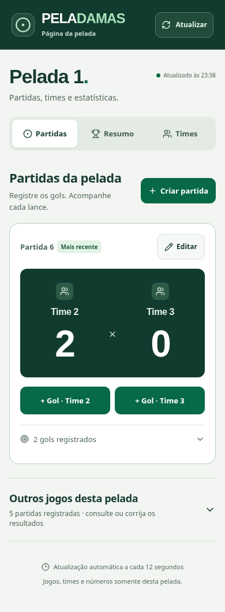
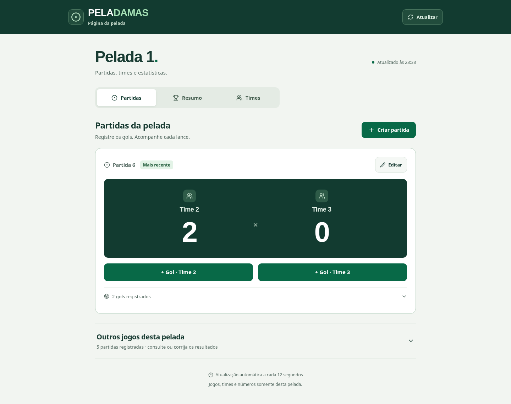

# Peladamas — teste de design

Branch: `teste-de-design`, baseada na main `077a0b8764ce804dff05ed9c05fd75c863a83bc1`.

## Objetivo e limites

Refinar a identidade verde existente usando o diagnóstico de UX. A página pública continua contendo apenas jogos, times e estatísticas da pelada do link. Sem navegação para outras peladas, sem login público e sem seleção de status de partida. Criar partida continua pedindo dois times; + Gol mantém somente autor e assistência; Editar permanece disponível em cada partida. Nenhum contrato de API ou formato de armazenamento mudou.

## Organização

A partida mais recente é o foco inicial, explicitamente identificada como tal, não como uma inferência de partida encerrada/em andamento. Os outros jogos da mesma pelada ficam em um histórico expansível, com edição e lançamento acessíveis. Placar é o primeiro conteúdo operacional; criação é uma ação contextual acima dele. Eventos do jogo podem ser consultados sem competir com os dois botões de gol. No celular, o formulário rápido usa uma coluna, eliminando rótulos quebrados; no desktop, usa duas.

## Sistema visual

Tokens em `src/design.css`: tinta #183b32; texto auxiliar #52675f; ação #086947; placar/header #123b30; superfície #fff; fundo #f2f5f1; borda #d7e2d9; foco #145bd6. Mesmas famílias já utilizadas: DM Sans para operação, Outfit para títulos e números. Escala de espaços 4,8,12,16,24,32,48. Bordas de 10–16px; superfícies sem sombras decorativas; apenas o login conserva elevação suave. Placar com números tabulares; controles de jogo48–50px e campos rápidos48px. Ícones Lucide no lugar de emojis decorativos novos.

## Correções de UX e acessibilidade

- Confirmação explícita antes de trocar times que possuem eventos no rascunho.
- Recuperação de conflito no gol mantém escolhas e pede revisão, sem reaplicar automaticamente.
- Aviso de saída com preenchimento não salvo.
- Foco visível global, estados aria-pressed, mensagens administrativas em região viva.
- Áreas de toque e legibilidade ampliadas; apelidos com área/intervalo adequados.
- Ranking com semântica ARIA de tabela; classificação pública rolável e focalizável.
- Redução de movimento respeitada.

## Fora desta rodada

Não foi implementado novo ciclo de status de partidas, alteração de permissões, reorganização dos arquivos de dados, restauração persistente de rascunhos ou mudança do algoritmo de sorteio. Links com aba/filtro na URL e a revisão do diálogo de inclusão de novos jogadores no Geral podem ser feitos após validar o visual. O aviso de saída usa o comportamento nativo do navegador e não recupera automaticamente um rascunho descartado.

## Como revisar

`git fetch origin`, `git switch teste-de-design`, `npm install`, `npm run dev`. Página pública de teste deve usar uma pelada criada/sorteada no ambiente local. Dados locais não são sincronizados com Vercel. A main e o deploy de produção não fazem parte da publicação desta branch.

## Capturas da branch

Dados fictícios, ambiente local. A página pública permanece apenas na pelada do link.

## Validação realizada

- 47 testes e build passaram.
- Fluxo completo no navegador: criar pelada, sortear/salvar times, criar partida, adicionar gol e assistência, refletir em outro navegador, corrigir via Editar, recalcular CSV e excluir a fixture.
- Sem overflow global nos estados avaliados em320,390,768 e1440px.
- Verificações Axe WCAG A/AA nas abas públicas e login/ranking; problemas identificados corrigidos nos estados verificados, sem alegação de certificação.
- Área dos botões de gol48px no celular e50px no desktop.
- Sem teste em telefone físico ou leitor de tela real; não houve gravação na produção.
