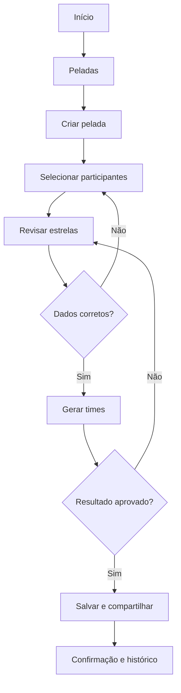
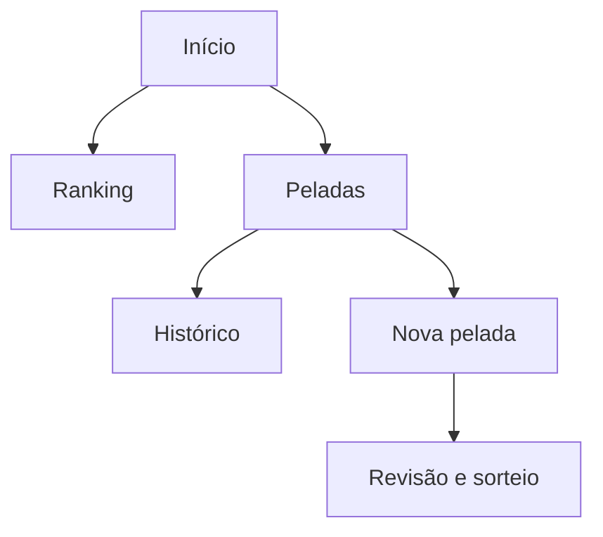

# Guia de UX e User Flow — Planejamento e Reorganização de Sistemas

> **Objetivo:** guia reutilizável para planejar sistemas novos e diagnosticar/reorganizar sistemas existentes, com foco em jornadas intuitivas, arquitetura da informação, navegação e validação.
>
> **Como usar:** coloque este arquivo na raiz do repositório. Peça ao Codex ou Claude Code: **“Leia `GUIA_UX_USER_FLOW.md` e siga o processo indicado. Primeiro apresente diagnóstico, fluxos e plano. Não modifique o código sem minha aprovação.”**
>
> **Complemento:** use `GUIA_FRONTEND_MODERNO.md` depois de definir o fluxo, para orientar visual, componentes, animações e 3D quando apropriado.

## 1. Princípio central

**UX vem antes do acabamento visual.** Um sistema bom deixa claro o que o usuário pode fazer, o que acontece após cada ação e como voltar ou corrigir um erro. Uma tela bonita não compensa uma jornada confusa.

- **User Flow:** sequência de passos e decisões para concluir uma tarefa.
- **Arquitetura da informação (IA):** como conteúdos e funcionalidades são agrupados e nomeados.
- **Wireframe:** esboço estrutural de uma tela antes da identidade visual final.
- **UI:** aparência, componentes, tipografia e animações.
- **Protótipo:** simulação navegável para testar hipóteses antes da implementação.

**Ordem recomendada:** objetivo → tarefas → fluxo → estrutura das telas → wireframe → protótipo → implementação → teste.

## 2. Dois caminhos de trabalho

### Caminho A — Sistema existente: auditoria e reorganização

1. **Inventariar** rotas, telas, menus, modais, permissões e ações, lendo o código e, quando possível, executando o produto.
2. **Definir tarefas críticas:** o que as pessoas realmente precisam concluir? Ex.: criar um evento, atualizar dados, compartilhar um resultado.
3. **Mapear o fluxo atual (AS-IS)** por tarefa, incluindo decisões, desvios, erros e voltas.
4. **Localizar atritos:** passos redundantes, nomenclatura ambígua, opções escondidas, formulários longos, falta de confirmação e becos sem saída.
5. **Propor fluxo futuro (TO-BE)** com menos fricção, sem remover funcionalidades essenciais.
6. **Criar mapa de navegação e wireframes** das mudanças; relacionar cada mudança a uma necessidade observada.
7. **Apresentar diferenças e riscos** antes de escrever código. Aprovação explícita é exigida pelo processo deste guia.
8. **Implementar em etapas pequenas**, preservar regras de negócio, contratos de API, permissões e dados existentes.
9. **Testar tarefas críticas** no desktop e mobile, incluindo erros e acessibilidade.

### Caminho B — Sistema novo: planejamento antes do código

1. Identificar perfis de usuário e objetivos reais.
2. Priorizar três a cinco tarefas centrais e definir o que significa concluí-las.
3. Desenhar o **caminho feliz** e os principais casos alternativos.
4. Definir o mapa de navegação, agrupamentos e nomes compreensíveis.
5. Elaborar wireframes de baixa fidelidade e verificar a coerência entre telas.
6. Validar o protótipo com usuários ou testes de tarefas.
7. Especificar estados, permissões, regras de negócio e critérios de aceitação.
8. Só então implementar a interface, seguindo também o guia visual de frontend.

## 3. Modelo para definir tarefas e jornadas

Para cada tarefa, registre:

| Campo | Pergunta orientadora |
| --- | --- |
| Perfil | Quem usa essa funcionalidade? Há permissões específicas? |
| Objetivo | O que deseja concluir? |
| Entrada | De onde a pessoa começa? |
| Pré-condições | Precisa estar autenticada ou ter dados cadastrados? |
| Caminho feliz | Qual é a menor sequência clara para chegar ao objetivo? |
| Decisões | Onde há escolhas, filtros, confirmações ou ramificações? |
| Exceções | O que ocorre se não houver dados, houver erro ou a pessoa desistir? |
| Saída | Como se confirma que a tarefa terminou? |
| Retorno | Como voltar, editar, desfazer ou retomar depois? |
| Métrica | Como observar sucesso, tempo, erros ou abandono? |

## 4. Diagramas: User Flow e sitemap

Use **Mermaid** no repositório para documentar os fluxos de forma versionável. Separe o fluxo atual (AS-IS) do recomendado (TO-BE).

Exemplo ilustrativo: criação e compartilhamento de uma pelada — **não representa necessariamente a implementação atual**.



**Sitemap** é diferente do User Flow: mostra a organização de páginas, não necessariamente a ordem de uso.



Evite desenhar um diagrama enorme: separe por tarefa e por perfil quando necessário.

## 5. Regras práticas para jornadas claras

- Deixe a **ação principal** de cada tela evidente. Evite várias ações competindo pela atenção.
- Use nomes de menus que reflitam a linguagem do usuário, não a estrutura do banco de dados.
- Mantenha navegação e padrões de interação consistentes entre telas.
- Mostre onde a pessoa está e o próximo passo quando houver etapas sequenciais.
- Evite exigir os mesmos dados duas vezes; preserve entradas ao voltar quando for seguro.
- Ofereça confirmação clara após ações que alterem dados; para ações destrutivas, inclua prevenção ou recuperação adequada.
- Planeje estados de **vazio**, **carregamento**, **erro**, **sucesso**, **sem permissão** e **sem conexão**, quando relevantes.
- Pense primeiro na tarefa principal, mas não esconda saídas, edição, cancelamento ou voltar.
- Não trate “menos cliques” como objetivo absoluto: clareza, segurança e previsibilidade importam mais.
- Respeite acessibilidade: navegação por teclado, foco, rótulos, contraste, mensagens de erro e leitores de tela.
- Considere telas pequenas, toque e comportamento responsivo desde o planejamento.
- Considere diferentes perfis e o que cada um pode ver ou modificar.

## 6. Wireframe: o que registrar por tela

Antes de trabalhar cores e animações, escreva:

1. Nome e **objetivo** da tela.
2. Contexto de entrada (de onde vem o usuário).
3. Conteúdo prioritário e hierarquia de informação.
4. Ação primária e ações secundárias.
5. Estados possíveis (vazio, carregando, erro, sucesso etc.).
6. Saídas e destinos (voltar, avançar, cancelar, editar).
7. Comportamento no mobile.
8. Permissões e restrições.

Ferramentas possíveis: **Figma/FigJam**, quadro branco ou papel; Mermaid para fluxos. O Figma não é obrigatório para começar.

## 7. Checklist de auditoria

### Navegação e clareza

- [ ] Consigo identificar a função de cada página e sua ação principal?
- [ ] Os menus estão agrupados por intenção do usuário?
- [ ] Cada tarefa possui início, conclusão e caminho de volta?
- [ ] O sistema mostra claramente em que etapa estou?
- [ ] Não existem telas ou ações duplicadas sem justificativa?

### Fluxos e estados

- [ ] As tarefas críticas possuem diagramas AS-IS e TO-BE?
- [ ] Foram mapeados erros, validações, cancelamentos e desistências?
- [ ] Há mensagens úteis de sucesso e falha?
- [ ] É possível corrigir entradas sem recomeçar toda a jornada?
- [ ] A experiência funciona com listas vazias ou dados incompletos?

### Qualidade

- [ ] Os principais fluxos funcionam no mobile?
- [ ] Teclado, foco e rótulos de formulários foram considerados?
- [ ] Nenhuma proposta quebra permissões ou regras de negócio?
- [ ] As mudanças foram testadas com tarefas concretas, não só pela aparência?

## 8. Métricas úteis (sem metas arbitrárias)

Meça antes e depois, quando possível:

- **Taxa de conclusão de tarefa:** percentual de pessoas que conseguem finalizá-la.
- **Tempo por tarefa:** tempo necessário para atingir o objetivo.
- **Erros e retrabalho:** quantas vezes voltam, corrigem ou repetem ações.
- **Abandono por etapa:** onde mais pessoas param.
- **Ajuda necessária:** quantas vezes precisam de orientação para prosseguir.

Não presuma melhoria apenas porque o novo fluxo tem menos telas. Compare uso real quando houver dados.

## 9. Entregáveis esperados do agente

Ao solicitar uma análise de UX, peça estes artefatos **antes da implementação**:

1. **Inventário** de telas, rotas e funcionalidades observadas (evidências do repositório).
2. **Principais tarefas e perfis**, distinguindo fatos de hipóteses.
3. **Fluxos AS-IS** em Mermaid, por tarefa.
4. **Lista priorizada de problemas** com severidade, impacto e causa.
5. **Fluxos TO-BE** em Mermaid e justificativa de cada mudança.
6. **Sitemap** proposto, wireframes e estados especiais.
7. **Plano incremental** por arquivos/telas afetados, riscos e critérios de aceitação.
8. **Plano de testes** de jornadas, regressão, acessibilidade e mobile.

Se o agente não puder executar o sistema, ele deve dizer que a análise se baseia no código e indicar o que ainda precisa ser validado com usuários.

## 10. Prompt pronto — projeto existente

> Atue como especialista sênior em UX, arquitetura da informação e frontend. Leia `GUIA_UX_USER_FLOW.md` e analise o repositório deste projeto.
>
> Primeiro inventarie rotas, páginas, menus, ações, permissões e tarefas críticas, citando arquivos relevantes. Mapeie os fluxos atuais AS-IS em Mermaid. Identifique fricções e proponha fluxos TO-BE, um sitemap e wireframes textuais para as telas afetadas. Considere mobile, acessibilidade, estados vazios, carregamento, erros, confirmação, edição, cancelamento e retorno.
>
> Entregue um plano de mudanças priorizado, com impactos, riscos, critérios de aceitação e testes de regressão. Distinga fatos observados de hipóteses. **Não altere o código nem regras de negócio antes de eu aprovar a proposta.** Depois da aprovação, implemente de forma incremental e valide os fluxos principais.

## 11. Prompt pronto — projeto novo

> Atue como UX designer e arquiteto frontend. Leia `GUIA_UX_USER_FLOW.md`. A partir do objetivo e dos requisitos deste novo produto, identifique os perfis de usuário, as três a cinco tarefas mais importantes e os critérios de conclusão.
>
> Crie o sitemap, fluxos de usuário em Mermaid (caminho principal e alternativas), wireframes textuais das telas, estados, regras de permissão e critérios de aceitação. Mostre suposições e decisões pendentes. Priorize simplicidade, clareza e usabilidade no mobile. **Apresente o plano antes de iniciar a implementação.** Quando o fluxo estiver aprovado, aplique também `GUIA_FRONTEND_MODERNO.md` para a camada visual.

## 12. Prompt curto para o dia a dia

> Antes de alterar a interface, leia `GUIA_UX_USER_FLOW.md`. Diga qual tarefa do usuário será melhorada, mostre o fluxo atual e o recomendado, identifique riscos e só então proponha a mudança. Preserve o comportamento existente até aprovação.

## 13. Organização recomendada do repositório

```text
meu-projeto/
├── GUIA_UX_USER_FLOW.md
├── GUIA_FRONTEND_MODERNO.md
├── docs/
│   └── ux/
│       ├── mapa-de-navegacao.md
│       ├── fluxos-as-is.md
│       ├── fluxos-to-be.md
│       └── decisoes-ux.md
└── src/
```

**Ritual antes de uma feature:** objetivo da tarefa → fluxo → telas/estados → critérios de aceitação → implementação → teste.

**Ritual antes de um redesign:** inventário → diagnóstico AS-IS → proposta TO-BE → validação → mudanças pequenas → teste de regressão.

---

**Regra final:** nenhuma animação ou refinamento visual deve dificultar uma tarefa central. **Primeiro a pessoa consegue usar; depois fazemos ficar incrível.**
