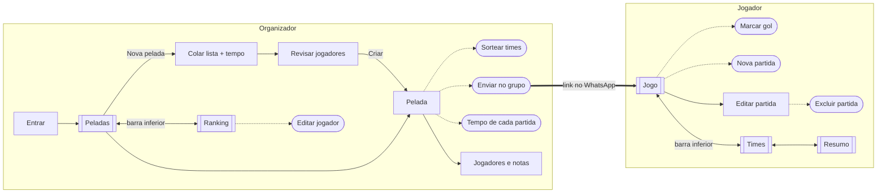

# Padrão de design do Peladamas

Este é o único documento de design do projeto. Quando ele e o código discordarem, corrija um dos dois na mesma alteração.

- Estilo: [src/styles.css](../../src/styles.css), um arquivo só, com as cores e medidas no topo.
- Componentes compartilhados: [src/ui.tsx](../../src/ui.tsx).
- Protótipo aprovado em 16/11/2026: https://claude.ai/artifact/JNaoVDUnSARyKeDpwFnTUP

## 1. Para quem é

O Peladamas é usado no celular, em pé, muitas vezes com uma mão só. Duas pessoas usam:

- **Organizador** (`/adm`, com login): cria a pelada, sorteia os times, manda para o grupo e mantém o ranking.
- **Jogador** (`/pelada/N`, sem login): marca os gols durante o jogo e confere times e resumo.

Toda decisão parte da tarefa mais repetida: **marcar um gol com o jogo rolando**. Ela precisa caber em 3 toques.

## 2. Mapa de telas

`[[ ]]` aba da barra inferior · `[ ]` tela · `([ ])` painel que sobe de baixo.

## 3. Navegação

1. **Abas ficam embaixo, no máximo três.** Organizador: Peladas e Ranking. Jogador: Jogo, Times e Resumo. Ações nunca viram abas.
2. **Telas internas têm "Voltar" no topo** (seta à esquerda) e título compacto. Telas de aba têm título grande e a marca PELADAMAS acima.
3. **Tarefas rápidas abrem num painel que sobe de baixo** (`Sheet`), por cima da tela atual: sortear, enviar, mudar tempo, marcar gol, nova partida, editar jogador, excluir. O painel fecha com X, Esc ou tocando fora.
4. **Formulários longos usam a barra fixa de ação** (`ActionBar`) embaixo, no lugar das abas: Nova pelada e Editar partida.
5. Ao trocar de tela, a página volta ao topo e o foco vai para o título.
6. **Links internos abrem na mesma janela**, nunca em aba nova: no app instalado no celular, uma aba nova sai da tela cheia e mostra a barra do navegador. Como o app instalado não tem o botão voltar do navegador, toda página aberta a partir de outra precisa do próprio "Voltar". O organizador abre a página da pelada em `/pelada/N?org=1`, que mostra "Voltar" e retorna para `/adm?pelada=N`, a mesma pelada de onde saiu.

## 4. Regras de cada tela

- **Um botão verde por tela.** Os outros são cinza (`subtle`) ou texto. Na pelada, o botão verde muda conforme a etapa: *Sortear times* → *Enviar no grupo* → *Abrir página da pelada*.
- **Toques em vez de menus suspensos.** Nomes e times aparecem como botões grandes (`.pick`). Números usam contador − e + (`Stepper`). Não use `<select>`.
- **Listas inteiras, com busca quando forem longas.** Sem paginação e sem alternar lista/grade.
- **Salvar na hora.** Cada jogador é salvo no próprio painel. Não existe "Salvar alterações" geral nem alteração pendente. A exceção é Editar partida, que é um rascunho até "Salvar partida", porque mexe em vários gols de uma vez.
- **Ações raras ficam no menu ⋯**: baixar planilha, excluir pelada, sair.
- **Confirmação de exclusão acontece no próprio painel**, com o nome do que será apagado no botão vermelho. Para descartar edição use `useConfirmation`, nunca `window.confirm`.
- **Sem botão "Atualizar" e sem dicas fixas.** As páginas se atualizam sozinhas a cada 12 segundos; o selo "ao vivo" mostra isso. Explicações cabem numa linha de texto auxiliar.
- **Avisos rápidos** (`useToast`) confirmam o que aconteceu ("Gol de Ana."). Erros ficam vermelhos, mais tempo na tela, e dizem como resolver.

## 5. Times

- **Cores fixas por posição:** Time 1 azul, Time 2 vermelho, Time 3 amarelo, Time 4 roxo, repetindo a partir do 5. A mesma cor aparece no placar, na lista de gols, nos times e na classificação (`TeamDot`).
- **"Time de Fulano".** Na página do jogador e no texto do WhatsApp, cada time é chamado pelo jogador de referência, que é o de maior nota do time (empate: ordem alfabética), escolhido no sorteio. "Time 1" aparece em letra menor. Usa-se "de" para não supor gênero.
- **Notas nunca aparecem na página pública.** O servidor envia só o `leaderId` de cada time.

## 6. Relógio da partida

- O organizador define o tempo ao criar a pelada (padrão 10 min, entre 1 e 90). Vale para todas as partidas da pelada e pode ser mudado em "Tempo de cada partida".
- Na aba Jogo, o relógio fica acima do placar da partida atual: *Iniciar*, *Pausar*, *Retomar*. Ao chegar a zero, fica vermelho, mostra "Tempo esgotado", vibra o celular quando possível e oferece *Zerar*. Não encerra a partida sozinho.
- O estado fica no servidor (`clock.startedAt` e `clock.elapsed` na partida), então todos os celulares mostram o mesmo tempo. Editar o placar nunca altera o relógio.

## 7. Visual

| Item | Valor |
|---|---|
| Fundo / superfície | `#f4f6f3` / branco |
| Texto / auxiliar | `#1a2921` / `#5b6b62` |
| Ação (verde da marca) | `#0b6b48`, fundo suave `#e3f1e8` |
| Perigo / atenção | `#b42318` / `#8a5300` |
| Fontes | DM Sans para tudo; Outfit para títulos e números do placar e do relógio |
| Títulos | 28px (aba), 19px (tela interna), 21px (painel) |
| Texto | 16px; auxiliar 13–14px; campos sempre 16px para o iPhone não dar zoom |
| Toque | mínimo 44px; botões 48px |
| Cantos | 12px campos, 14px botões, 20px cartões, 24px painéis |
| Largura | coluna de no máximo 600px, centralizada no computador |

Cartão com borda só para separar um grupo (placar, próximo passo, listas). Sem sombras decorativas, gradientes ou vidro fosco.

**Movimento:** painel sobe (0,32s), tela nova desliza da direita, volta desliza da esquerda, troca de aba faz um fade curto. Tudo é desligado quando o celular pede menos movimento. Nenhum conteúdo depende de animação para ficar visível.

## 8. Componentes

| Componente | Use para |
|---|---|
| `TopBar` | Título de toda tela. `onBack` em telas internas, `brand` nas abas, `right` para ⋯ ou selo. |
| `TabBar` | Barra inferior de abas. |
| `ActionBar` | Botão principal fixo em formulários e edição. |
| `Sheet` | Qualquer tarefa rápida ou confirmação de exclusão. |
| `Stepper` | Números: nota (0,5 a 5), jogadores por time, minutos. |
| `Switch` | Sim/não com explicação curta. |
| `.choice` com `role="radio"` | Escolher uma entre poucas opções explicadas (modo de sorteio). |
| `.pick` | Escolher jogador ou time com um toque. |
| `useToast` | Confirmar ações e mostrar erros. |
| `useConfirmation` | Confirmar descarte de alterações. |
| `TeamDot` | Cor do time ao lado do nome. |

## 9. Texto

Escreva como quem joga fala: "Sortear times", "Enviar no grupo", "Gol", "Sem assistência". O botão diz exatamente o que acontece, e o aviso depois confirma ("Partida salva."). Erros dizem o que houve e o que fazer ("Senha da pelada incorreta. Peça a senha ao organizador.").

## 10. Como mudar o design

1. Mude o valor no topo de `src/styles.css` ou o componente em `src/ui.tsx`. **Não crie outro arquivo de estilo por cima**: foi o empilhamento de cinco arquivos que travou o design anterior.
2. Atualize este documento na mesma alteração.
3. Confira no navegador com 390px de largura (e 320px nas telas com placar) e rode `npm test` e `npm run build`.

## Histórico

- **16/11/2026, redesenho mobile:** navegação embaixo, painéis, um botão principal por tela, relógio da partida e "Time de Fulano". Substituiu os documentos anteriores (`DESIGN.md`, `docs/design/revisao-interface-limpa.md`, `docs/ux/*`, `docs/design-system/*`), que descreviam o visual em camadas. Eles continuam no histórico do git.
