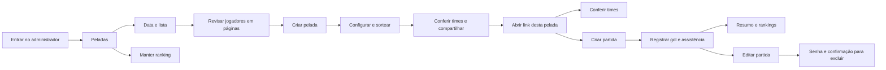

# Peladamas — jornada e reorganização

Ferramenta operacional para organizar futebol entre amigos, principalmente no celular. Objetivo: criar uma pelada, formar times e compartilhar; durante o jogo, registrar gols rapidamente. Identidade: cabeçalho original, DM Sans/Outfit, verde #08764f, superfícies brancas, cores próprias dos times. Nenhum dado de produção foi usado na validação.

Fluxograma editável: https://www.figma.com/board/sdPGfuD6sSL2D307zHrwjP

## Dois públicos

**Organizador:** entrar → escolher pelada ou criar → data e lista → revisar participantes e estrelas → consentimento conjunto para adicionar novos ao ranking → criar → configurar sorteio → conferir times publicados → compartilhar link e, quando necessário, senha de exclusão.

**Jogador:** abrir o link da pelada → conferir times → criar partida escolhendo os times → registrar autor e assistência → consultar resumo → corrigir partida. Exclusão exige senha da pelada e confirmação. Não há catálogo de outras peladas na página pública.

## Atritos observados no código e decisões aplicadas

| Antes | Mudança | Motivo |
|---|---|---|
| Ranking abria primeiro, mesmo para organizar um jogo | Entrada em Peladas; Nova pelada e Ranking acessíveis na mesma navegação | Começar pela tarefa principal |
| Criar e consultar eram modos dentro de Organizar | Nova pelada acessível diretamente | Evitar navegação aninhada |
| Lista e revisão na mesma página longa | Duas etapas; revisão de quatro nomes por página | Reduzir rolagem e manter contexto |
| Voltar à lista podia refazer a análise e perder notas ajustadas | Retorno preserva revisão enquanto a lista não muda | Permitir conferência segura |
| Link vinha antes de selecionar a pelada | Seleção primeiro, compartilhamento depois | Deixar claro qual pelada será compartilhada |
| Correção de notas explicada como instrução para outra aba | Ação direta “Corrigir notas desta pelada” | Levar ao histórico correto |
| Configurações ocupavam espaço mesmo após sortear | Configurar sorteio expansível; abre após criar e fecha ao concluir | Reduzir competição com o resultado |
| Público: Partidas, Resumo, Times | Partidas, Times, Resumo | Aproximar registro de jogo e escalação |

## Skills aplicadas e limites

- **Taste:** https://github.com/Leonxlnx/taste-skill — critérios de sistema único, cópia direta, alinhamento, hierarquia e interação. A skill atual é orientada a sites de apresentação; receitas de hero, fotografias, paletas aleatórias e cenas foram dispensadas porque este pedido é reorganizar uma aplicação existente preservando sua identidade. Não há alegação de aprovação pelo gate de páginas de marketing.
- **Transitions.dev:** https://github.com/Jakubantalik/transitions.dev — snippet original de tabs sliding em `src/components/transitions.css`, com tokens de tema e dimensões adaptados no CSS da aplicação. Medição sem animação no primeiro desenho/resize; transição apenas em troca de aba; suporte a movimento reduzido.
- **React Bits:** https://reactbits.dev/components/stepper — Stepper TS/CSS obtido do registro público atual; arquivos em `src/components/Stepper.*`. Adaptado para Lucide já instalado, ausência de APIs de browser, pane de saída inerte e movimento reduzido estrito. Licença em `react-bits-LICENSE.md`. Nenhuma dependência de animação adicional.

## Requisitos preservados

Página pública restrita ao link. Login administrativo e regras de armazenamento preservados. Mesmos três algoritmos e mesmo padrão. Criação de partida continua pedindo apenas dois times; +Gol continua com autor/assistência. Edição compacta e senha de exclusão desta branch mantidas. Dados são gravados apenas após confirmação; navegar para trás não cria peladas.

## Fluxograma em fonte

## Validação executada

- 75 testes em 12 arquivos e build TypeScript/Vite passaram.
- Fluxo em Chromium com banco Neon isolado: login, criação, revisão paginada, sorteio, página pública, criar partida, gol/assistência, resumo, times, editar resultado e excluir pelada. API pública respondeu 404 após exclusão. Nenhum erro JavaScript.
- Revisão de participantes: 320, 390, 768 e 1440 px; sem overflow horizontal; axe WCAG 2 A/AA e 2.1 AA sem violações nesses estados. Isso não substitui uma auditoria completa de todas as telas.
- Movimento reduzido: navegação entre etapas continua legível e sem animações; indicador de abas sem animação.
- Testes de unidade verificam retorno à lista preservando nomes corrigidos e bloqueio com menos de quatro jogadores.
- Não foram executados teste de carga ou validação em Safari/aparelhos físicos. Nenhum dado de produção foi modificado. Nenhuma alteração de algoritmo, credencial ou estrutura de armazenamento.
