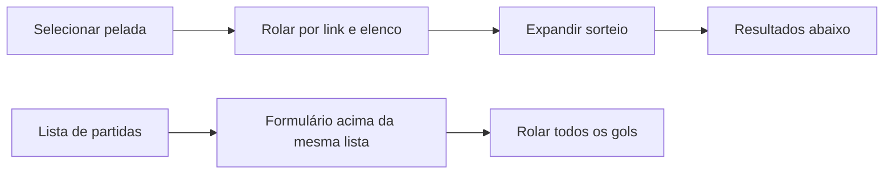
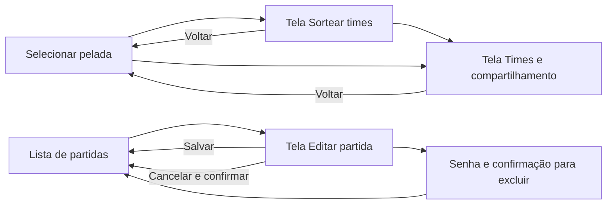

# Revisão: menos rolagem e telas dedicadas

Base: branch design/jornada-do-usuario. Referências fornecidas: GUIA_UX_USER_FLOW.md e GUIA_FRONTEND_MODERNO.md. Este documento aplica diagnóstico, proposta, estados e critérios ao pedido concreto do usuário de separar sorteio/edição e criar o design system. Os exemplos e prompts nos guias são referências, não ações adicionais solicitadas.

## Diagnóstico AS-IS

- `src/App.tsx`: seleção, compartilhamento, elenco, configurações, resultado, texto dos times e gerenciamento coexistiam na mesma tela. Abrir o sorteio exigia procurar um bloco abaixo do compartilhamento.
- `src/PublicPelada.tsx`: edição montada antes da lista de jogos; contexto e formulário competiam visualmente, e muitos gols alongavam a página.
- Tokens e componentes estavam distribuídos pelo CSS; não havia um catálogo de telas de tarefa.

## Proposta TO-BE e wireframes

**Peladas:** seleção → dois botões (Sortear times / Times e compartilhar) → elenco recolhido → gerenciamento secundário. Sem formulário de sorteio empilhado.

**Sorteio:** voltar + contexto da data → jogadores por time → método → Sortear times. Resultado leva à tela de compartilhamento.

**Times e compartilhamento:** voltar + contexto → abrir página/copiar link/senha privada → um time por vez → texto de WhatsApp recolhido. Uma pelada que já tinha times antes de abrir o painel continua acessível pelo botão Abrir página da pelada.

**Edição de partida:** voltar + contexto → alterar times recolhido → placar → gols compactos paginados (4 por página) → salvar/cancelar → excluir. A lista e a navegação pública não são renderizadas nesta tela. Criar partida também usa tela dedicada e mantém somente os dois times.

## Estados, riscos e critérios

- Dados e regras de negócio preservados. Rotas, contratos de API, algoritmos e autenticação não mudaram.
- Voltar/cancelar edição pede confirmação; salvar retorna aos jogos. Erros preservam o formulário; conflitos exigem revisão.
- A paginação deve usar o índice original de cada gol para editar/remover corretamente. Ao adicionar um gol, exibe sua página.
- Muitas informações ainda exigem rolagem natural. O objetivo é remover empilhamento de tarefas, não cortar conteúdo nem travar a altura da tela.
- Glassmorphism restrito a navegação/contexto; suporte a fundo sólido e movimento reduzido.
- Testar criação, sorteio, compartilhamento, gols, edição, cancelamento, exclusão e retorno; 320/390/768/1440; foco, teclado, contraste e build.

Design system: [documentação](../design-system/README.md).

## Validação concluída

- 78 testes automatizados e build TypeScript/Vite aprovados.
- Jornada real no Chromium/Neon isolado: criar, sortear, publicar, abrir página, criar partida, gol/assistência, resumo, times, editar, salvar e excluir pelada.
- Exclusão de partida na tela dedicada: senha incorreta bloqueia; cancelar preserva a partida; senha correta remove somente o jogo escolhido e recalcula as estatísticas.
- Editor em 320, 390, 768 e 1440px: sem overflow horizontal; axe WCAG 2/2.1 A/AA sem violações nos estados conferidos. Movimento reduzido mantém a interface utilizável.
- Novo teste impede que o sorteio use a pelada anterior durante o carregamento de uma recém-criada.
- Sem teste de carga ou aparelho físico/Safari. Nenhum deploy e nenhum dado de produção alterado. Dados fictícios usados somente na branch de banco de validação.
